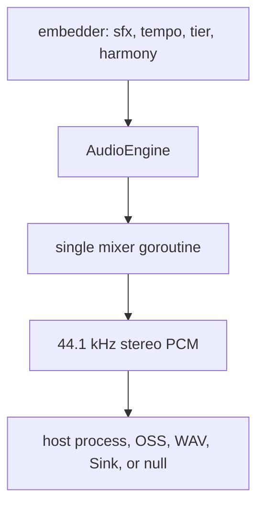
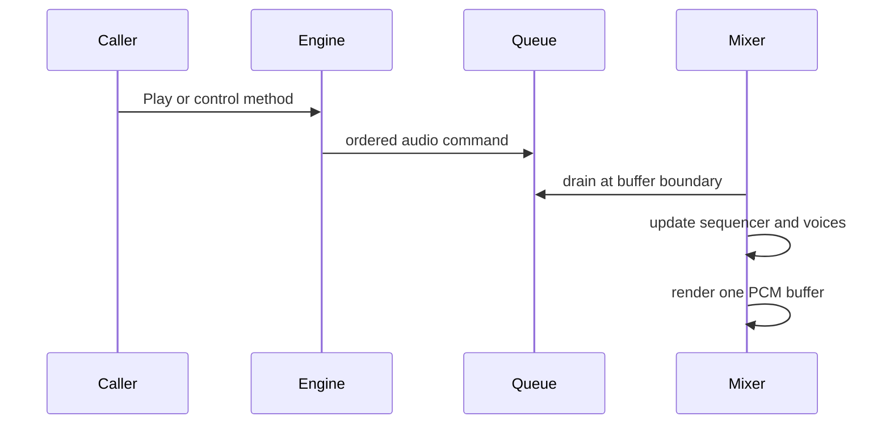
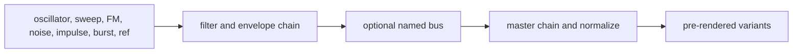

# Audio

A pure-Go synthesis, sound effect, mixing and music-sequencing engine. It streams
raw PCM to a host process, a device, a WAV file or a writer its embedder hands
it; there is no cgo. The [README](../README.md) is the tour and the embedding
example; this document is the design.

Three words name what it plays, in code and documents alike:

- **audio** is everything: the engine, its backend, the channel mutes, the pause;
- **music** is what the sequencer plays: patterns (beats, melodies, basses and
  fills) on the music bus, arranged by group, tier and motif;
- **sfx**, a sound effect, is a sound played on a trigger outside the music, on
  the sfx bus.

A **sound** is the synthesized one-shot both draw on: an sfx plays one, and so
does each drum of the music's kit (§5, §7).

## 1. Layered design



- `AudioEngine` is the thread-safe control surface: the sound and pattern
  registries and the backend's lifecycle and failover.
- `Mixer` owns every live voice and the sequencer, and renders the output
  buffers.
- The backend consumes signed 16-bit little-endian stereo frames.

The engine carries no game concept. Its embedder hands it the sfx levels and
sound shapes by sound name (`SfxLevels`, `SoundShapes`) and sets the tempo, the
tier and the harmony from whatever drives its music; vif's conductor reads them
off the player's actions a minute. Beside the standard library the root package
imports only `lixenwraith/toml` and its `macro` expander, and `ripmodel` adds
`lixenwraith/transformer`. No file carries a build tag, so every package builds
wherever Go does. `model` holds the identifiers an embedder's protocol carries
(sound, instrument, pattern, scale and tier) with no mixer, backend or synthesis
dependency, for builds that leave the engine out. The root package ships no
sounds, voices or patterns; `bank` embeds the ones vif and stapes ship.

## 2. Stream contract

- 44,100 Hz, two channels (the mix is mono, written to both), signed 16-bit
  little-endian PCM, four bytes a frame;
- a 50 ms buffer (`AudioBufferDuration`) unless `AudioConfig.Buffer` names
  another, 441 frames per 10 ms (2,205 at 50).

Every mixer pass drains pending commands, renders music and sfx into separate
floating-point buses, sidechain-ducks music under sfx, applies the pause gain
ramp, holds the sum under a peak limiter (it sees each peak 64 samples ahead and
ramps its gain over that time, releasing over 80 ms, so stacked kicks duck
without a click), converts samples, and writes one PCM buffer. The output writer
is the only backend-specific part of that path.

## 3. Backend detection and failover

Automatic candidates are tried in this order:

1. `pacat`, the PulseAudio protocol, also commonly available through PipeWire
   compatibility;
2. `pw-cat`, native PipeWire;
3. `aplay`, ALSA command-line playback;
4. `sox`, the SoX `play` executable;
5. `ffplay`, FFmpeg playback;
6. `oss`, `/dev/dsp`, considered only on FreeBSD.

Detection first checks executable/device availability. Attachment starts a
candidate, writes one silent buffer, and waits through a short survival window;
bad arguments, an unavailable daemon, or an immediate broken pipe fall through
to the next candidate. A process that accepts data but routes it nowhere cannot
be detected by this probe. The supervisor can move to an untried candidate if the
active process exits; the backend's lifecycle has its own mutex because failover
and shutdown can race.

`AudioConfig.ForceBackend` restricts selection to one backend by name, or to one
of two synthetic backends, never detected, that automation uses: `null` runs the
full mixer and discards samples, and `wav:<path>` captures the live stream into a
finalized WAV file. `RecordMusic` writes the music bus alone, before ducking, to a
WAV file: what plays, so a muted or paused stretch adds nothing. It needs a
running mixer, which `null` gives a machine with no device.

If no backend survives, `Start` returns `ErrNoAudioBackend` and the engine stays
valid and silent: sound requests become no-ops with rejection telemetry, so the
absence of a device need not fail the embedder's start.

A host that has its own speakers skips detection: `AudioConfig.Sink` is a writer
the mixer streams to as the `host` backend, whatever name was forced. Unlike the
WAV and OSS sinks it is not closed with the engine: the host's speakers outlive a
run, and the next `Start` streams to the same writer.

## 4. Concurrency and command ownership



Playback, transport, tempo, patterns, harmony, and hot reload share one command
channel, preserving arrival order. Pause and music mute are flags the mixer
reads each pass, and sfx mute rejects a play before it is queued. The live
sequencer, pattern players, voices, sounding sfx, and buses are confined to
the mixer goroutine and need no inner locks.

Commands sent before `Start` are retained in a 64-entry ordered buffer. After
startup, the mixer channel holds 256 commands. A full queue rejects the command;
play rejections are categorized as not running, silent, paused, muted, bad ID,
or queue full, and `Stats` and `Rejections` report the played and dropped totals
and the categories.

Shutdown stops the mixer and backend with a bounded wait, so a wedged audio
process cannot hold up the embedder's own shutdown, such as restoring a
terminal's raw mode.

## 5. Sounds and sound effects

A sound is a declarative `SoundDef`: one or more layers, optional intermediate
buses, and processor chains. `Play` sounds one as an sfx; the drum kit plays
four as instruments (§7).



Sources include oscillators, sweeps, FM, noise, impulses, burst trains,
references to earlier layers, and silence. Processors include filters,
envelopes/decay, modulation, shaping, clipping, gain, and an equalizer (`eq`):
a gain in dB at each of its bands' centres, smooth between them on a log axis
and flat past the outer ones, applied with no phase in one transform of the
whole buffer, the curve exact at every bin. Validation bounds
duration, frequencies/Nyquist behavior, topology, operation count, and authored
structure before rendering.

A sound may be rendered once a velocity (`velocities`, up to four), its variant
set a layer. A layer's gain follows the velocity to its `vel_gain` power; an
oscillator's or a sweep's start frequency, a filter's frequency, a decay's tau
and a shaper's drive to their `vel_track` power. Each variant is a stroke landing
at its own place in [-1, 1], spread over the set in a seeded order and the same
in every velocity layer, and `stroke` scales a gain or a parameter by it. A
sound that sets none of these renders once at full velocity, as every sfx does.

At startup the engine:

1. registers `AudioConfig.BaseSounds` and `BaseVoices`, which an embedder fills
   from `bank.Sounds` or from documents of its own;
2. loads the sound document `SoundFS` and `SoundFile` name, with its includes,
   its sounds and voices replacing same-name definitions and a new voice name
   adding an instrument;
3. freezes the name-to-ID registry of sounds;
4. pre-renders the variant cache, under the embedder's sound shapes
   (`SoundShapes`), and the kit: the drums' velocity layers and the tonal voices;
5. resolves the embedder's sfx levels (`SfxLevels`) by stable sound name, a sound
   it gives none playing at `DefaultSfxLevel`;
6. registers `melody_gen`, `BasePatterns` and the `PatternTOML` document (same
   name replaces), and builds the group arrangement before probing backends.

Each sound normally has three pre-rendered variants. The mixer rotates variants
to reduce repetition, allows at most two concurrent sfx per sound and 12 in all,
and steals according to its admission policy when needed. Rapid repeats within
250 ms attenuate toward a 0.25 floor and recover over 600 ms. Sounding sfx duck
the music bus to 70%, with fast attack and slower release; the sfx volume
(`SfxVolume`) scales every sfx and leaves the music alone.

Sound IDs are process-local registration values: configuration and persistent
documents name sounds, and `SoundID` resolves a name once `Start` has frozen the
registry. A name an embedder resolves only as it plays skips the resolution of
its levels at startup, so a mistyped one is silent and counts only as a bad-ID
rejection.

## 6. Mixer buses, mute, and pause

Sfx and music have independent mute bits (`SetSfxMuted`, `SetMusicMuted`). Pause
(`SetPaused`) is an output state: it ramps the master gain over 250 ms, and music
plays out the ramp, then freezes with its position kept for resume. `FadeOut`
fades the same way and waits it out before a `Stop`, so a run that ends does not
cut its sound off mid-note.

A sequencer slot mutes alone (`SetSlotMuted`): its pattern plays on in time,
silent, so it comes back on the step it has reached, and the mute outlasts a
change of pattern. A track mask (`SetTrackMask`, a bit a track, which the reveal
also drives) silences tracks of one pattern: the slot holds it for that pattern
and sets it whenever the pattern begins there, so a mask set while the slot waits
for its bar line lands with it, and another pattern begins whole.

## 7. Music sequencer

The sequencer uses a 16th-note grid (`4` steps per beat) and four crossfading
slots: 0 rhythm or drums, 1 melody or a harmony-following layer, 2 a free layer
or the automatic phrase fill, 3 the bass, the group's anchor.

A bar is its meter's (`Meter`, `SetMusicMeter`), 4/4 unless set. A step is a
sixteenth in every meter and the tempo counts quarters, so a bar of n/d holds
16n/d steps: 3/8 six, 3/4 and 6/8 twelve, 12/8 twenty-four, and a song in 6/8
at 140 is felt in dotted quarters at 93. The patterns count their steps from the
bar the meter took effect on, the next bar line when it is set while the music
runs, and each plays that count modulo its length, so a pattern of whole bars
starts each on a line; `Transport` reports the bar and the count, `MusicMeter`
the meter. A pattern or a song names its meter in its document (`meter =
"6/8"`, left out for 4/4): a song's is the bar its timeline plays in, a
pattern's the bar its editor and its MIDI file show. A song's bar may name a
meter or a tempo of its own at the head of its list (`["2/8", "72bpm",
"fe_melody_c", ...]`), each holding until a later bar names another
(`SongDef.Heads`, `BarHead`): a bar a score cuts short, or a played take's
rubato, which a rip's song writes where a bar's tempo moves three per cent
from the last named; the sequencer takes them at the bar line as it takes the
slots (`RenderBars`, and stapes' `song play`), and the MIDI file carries them
as events there. The tempo a player reads is the beat the meter is felt in
(`Meter.FeltTempo`): a 3/8 at 73 is eighth 147, a 6/8 at 140 dotted quarter
93. The bank's music is 4/4.

A pattern has up to 64 steps, 32 tracks, and 512 events per track. A track sets
its instrument, chord-following, and humanization; its events set step position,
velocity, scale degree, octave, an accidental (`acc`, the semitones off the
degree, so a note outside the key is written exactly), duration, and
probability. The tonal voices are data: a `[[voice]]` of the sound document
names an instrument and its synthesis, an oscillator stage (sine, saw or square),
with a vibrato and a vowel's formants if a voice has them, through a resonant
low-pass under a filter envelope into an ADSR, or a string, as a delay line or as
its partials (`VoiceDef`). The five `bank` ships are `bank/voices.toml`; a
document's voice of a shipped name retunes that instrument in place and a new
name adds an instrument, which patterns name as they name any. `DefineVoice`
hot-swaps one: the next note plays the new voice while a sounding one finishes on
its own, and an instrument no voice defines plays a plain sine.

Of the shipped voices, the pad and the lead are band-limited saws. An oscillator
voice's unison runs free: each oscillator of a stack starts at its own phase (a
lone one at 0), seeded by the note and its trigger order so a replay plays the
same, and a detuned one wanders about its place in the spread by up to three
tenths of the detune, over 3 to 14 s; the filter envelope (`env_amount` at full
velocity) opens as far as the velocity takes it, and `drive` rounds the pad's
edge as it does the lead's. A string is never held at a sustain: it fades as it
rings, a held note ends on its own, and the note-off is its damper (`release`);
the ADSR's decay and sustain shape the oscillators alone.

The pluck is a delay line after Karplus and Strong with Jaffe and Smith's
extensions: a seeded noise burst, through the comb of where it is plucked
(`strike_pos`) and a low-pass that darkens a soft note (`hammer_hz` at full
velocity), with its mean taken out, rings in a line of the period's whole samples
and a first-order all-pass for its fraction, so every note is in tune; the loop's
two-point low-pass (`bright` its stretch) and a loss per period derived from
`ring`, the fundamental's T60 at middle C, set that decay, the low-pass lessened
where its loss alone would cut a high note short. As in the modal voices,
`decay_track` shortens it above middle C and lengthens it below (none keeps
`ring` at every pitch); the pluck's 1.1 is a recorded guitar's slope, its T60
halving about every octave.

The bass and the piano are modal voices: a string as its partials, each a
decaying phasor at `k·f0` stretched by the string's inharmonicity, at the
amplitude the strike position's comb, the spectral tilt (1/k struck, 1/k²
plucked), the body and the hammer leave it, decaying faster the higher it sits.
The body is a third-order high-pass at `bright` kHz: a soundboard radiates the
partials under it weakly, as a piano does its bass fundamentals. The hammer is a
low-pass at `hammer_hz` times the velocity to the 1.5, so a soft note is darker
as well as quieter, a recorded piano's pp a third of an octave darker than its
mf. The lowest partials the body sounds carry a second, slightly detuned string
whose slower aftersound gives the double decay; both start in phase, and a beat
that would leave them over a quarter cycle apart where the second overtakes the
first moves to a quarter, so the hand-over never cancels the partial. A few
milliseconds of filtered noise are the hammer or finger contact. The piano has a
grand's stretch, its decay, brightness and dynamics fitted to a recorded piano's
notes at pp, mf and ff (the University of Iowa samples, C1 to C7); the bass is a
pizzicato double bass fitted the same way to Iowa's, a thump that falls away
within a second, its note-off a 45 ms damper.

The drum kit plays cached sounds: a hit takes the next stroke of the velocity
layer nearest its velocity and plays it at that velocity, so a harder hit is
brighter as well as louder. The shipped pieces follow published methods. The
kick's fundamental falls from 92 to 52 Hz as the head's tension settles, from
higher the harder it is struck, with two upper modes, the beater's pulse and its
felt. The snare is its (0,1) mode split in two by the coupled heads and three
upper modes under the stick's crack and the wires, a soft stroke ringing
shorter. The hihat is the TR-808's six square partials and noise through the
plates' band, choked as they close, the clap four noise bursts a few
milliseconds apart and then the room. A drum plays the sound of its own name
unless `SetKit` binds it to another, live and in `RenderLines` alike, as a song
plays the kit its rip matched (`SongDef.Kit`, §9). Strokes differ where they land (centre or
edge, a hat's tip or shoulder), not in pitch. Against recordings free for any
use (Freesound CC0 kits, Iowa's hihat), levels re peak at 50/100/250 ms and the
centroid of the first 100 ms, soft to hard:

```
        kit                                   recordings
kick    -10/-20/-36 .. -9/-17/-35   80..337   Sonor p1..p6 -10/-10/-25 .. -8/-19/-27   86..311
snare   -14/-25/-45 .. -7/-14/-35  430..417   Pearl light, hard -14/-23/-41, -6/-15/-35 301, 318
hihat   -12/-22/-41 .. -10/-20/-40 6250..7540 Iowa mf, ff -10/-26/-38, -9/-24/-26      7855, 7813
clap     -6/-16/-46               2280..2530  four players' claps -1..-14/-14..-31     1480..2650
```

Tempo is clamped to 40–200 BPM, the floor low enough for a 3/8 or a slow 4/4
at its own tempo (the rip tracks beats in 80–200 and names a bar's tempo
within the wider range). Tempo changes can wait for the next beat;
patterns can transition immediately or quantized to the bar. The incoming
pattern plays at full level from its first trigger while the outgoing one's
ringing tails fade out, over at least 256 samples so none is hard-cut; a slot
holds three players, so a transition arriving while the last one still fades
retires a second tail rather than cutting the first. A change with no fade,
as a song makes at its bar lines, fades nothing: the incoming pattern plays on
the outgoing one's player, under the notes it still rings. A reveal builds a
rising tier up from as many tracks as the outgoing pattern sounded, adding one a
bar, so a build-up never starts thinner than what it replaces. Slot 2 substitutes a
seeded fill on the last bar of each eight-bar phrase and restores the previous
pattern on the downbeat. The fill is on by default; `SetAutoFill(false)` turns
it off.

Drawn music comes from groups. A pattern's `role` (rhythm, melody, fill or
bass), `groups` and `tiers` place it; `Start` builds each group's pool per tier
and role from the registry. A group's bass patterns are its anchor: a tier change
keeps the bass that still covers the tier and redraws rhythm and melody, so what
the group plays follows what it played before. The sequencer holds one group,
moving only when it does not cover the tier; each phrase downbeat swaps one drawn
slot, melody, rhythm and bass in turn, to another member of its pool, once four
bars have passed since any drawn slot changed; and after four phrases every drawn
slot moves to another group behind the phrase's fill. A draw takes the pool
member played least this run, so a held tier works through its pool before
repeating.

Three ideas organise the drawing, from the outside in:

- **group**, a style: one bass figure and kick feel, with its own rhythms,
  melodies, basses and fills (`groups`); every drawn slot moves to another
  together after four phrases;
- **tier**, how much is going on, calm to peak (`tiers`), which the embedder sets
  (`SetIntensity`), as vif's conductor does from the action under hysteresis;
- **motif**, one melodic idea at five weights, one per tier, within a group
  (`motif`): the ladder a melody climbs and descends as the tier moves; a phrase
  variation moves to another motif, after a rest bar.

So a tier change keeps the melody's motif and takes its member at the new tier,
which for the shipped themes is the same line with more or fewer layers under
it, and only a phrase variation changes the idea: the melody then fades out
through the fill bar and the new motif enters alone on the downbeat. A melody
change quantized to the bar lands on the end of the pattern's own cycle, so a
four-bar theme is heard through. Fills come from the same group and tier. A slot
placed explicitly is left alone.

Harmony holds root note, scale, and chord progression. Pattern degrees resolve
through the current harmony at trigger time. With the same seed (`SetMusicSeed`)
and identical bar-aligned command schedule, generated music is reproducible;
wall-clock arrival relative to bars is not a replay contract, but draws and steps
roll on separate streams of the seed, so a bar of skew between two runs moves no
later draw: the arrangement holds where the notes under it differ.

## 8. MIDI files

MIDI goes through one table, `midiInstruments` in `midi.go`, a row a shipped
instrument: a kit piece's General MIDI keys on the drum channel, the first the
one written, and a voice's program with the families of eight programs read back
as it (pianos, chromatic and pitched percussion the piano, basses the bass,
guitars and plucked strings the pluck, organs, strings, ensembles, pads and
effects the pad, brass, reeds, pipes and synth leads the lead), so a program no
row writes plays on its family's voice. A voice a document added is written on
the program of the shipped voice nearest it, its wave first, then its genes
(`midiProgram`).

- Writing (`WriteSongMIDI`, `WritePatternMIDI`): a type-1 file whose first track
  holds the tempo, the key signature and the song's meter as its time signature,
  then a track a pattern track by slot, instrument and order, each note its steps
  long at its velocity, resolved through the song's harmony as the sequencer
  resolves it; a drum a sixteenth on channel 10. A pattern is a song in its meter
  that plays it once through. Probability, humanize and tuning are not written.
- Reading (`MIDIScore.Song`): the file's parts quantized on its ticks, a step its
  sixteenth at its first tempo folded by octaves into the sequencer's range, as
  `MIDIScore.Rip` folds; a pattern a part a bar, named and shared between bars as
  `Rip.Song` names them (§9), the drum channel the beat, a part on a bass
  program the bass and the rest the melody, a track a line, each note at its
  velocity and length; and the song that plays them, in the meter its music
  starts in and the key signed or the key the notes hold. A signature is read at
  the folded tempo (`foldMeter`) when the file's falls outside 40–200: 3/8 at
  30 is 3/4 at 60, as a bar is the same time and a step a sixteenth at the
  tempo played; one no bar of the grid holds is read in 4/4. A bar of another
  meter, or cut short by the next signature, names its meter at its head, and
  a bar the tempo map changes names its tempo, so the song plays the file's
  changes (§7). It returns what it could not keep, a line each: a meter no bar
  holds, a program played on its family's voice, a key the kit lacks, notes
  merged, cut or left out.
- `ReadMIDI`'s transcript (§9) is the same with or without the programs, keys
  and signatures the reader takes for a song
  (`TestReadMIDIReadsTheSameTranscript`).

## 9. Ripping a recording

`RipWAV` and `RipSamples` listen to a recording and estimate what the sequencer
would need to play it: the tempo, the meter and where the bars fall, the key, the
chord root each bar leans on, and per bar the kick, snare and hihat hits, the
melody and the bass line as steps of the sixteenth grid (`Rip`). `Patterns`
writes them as patterns of up to four bars, named `<name>_beat_<n>`,
`<name>_melody_<n>` and `<name>_bass_<n>` in a group of their own and no tier.
`ReadWAV` reads the file, any PCM or float width. A `Ripper` with a `Grid` pins
the tempo and the downbeat, as a render's are known, in bars of its `Meter` or
4/4; a grid with a negative downbeat pins the tempo alone, the beats tracked at
it and the bar line decoded, for a recording whose tempo the listener knows or
wants on another metrical level. `Ripper.Meter` alone pins the meter and leaves
the rest to decode.

The analysis runs at 22.05 kHz over 93 ms frames every 11.6 ms, each split into
a harmonic and a percussive part by the medians across time and across frequency
around it. It reads the recording's tuning first (`Rip.Tuning`): over windows
four times longer, every spectral peak votes its offset from the nearest
semitone, and the pitch table is read on the mean offset, so a clip tuned forty
cents flat, where every note sits between two semitone rows and wobbles between
them, reads as one in tune. The percussive onsets, each drum's band against its
own peak with the kick's counting double, give the tempo (autocorrelation under a
log-Gaussian prior centred on 120 BPM, folded into 80–200) and the pulses the
bars are read over (a dynamic programme that holds to the period): the tatum,
three pulses a beat when the beats hold onsets on both their thirds (a swung
beat sounds near its second third alone), else the finer of two or four whose
lag is a peak of the onset autocorrelation at least half the beat's, each
spanning 140 ms at least, else the beat itself (`tatum`). A hit is a kick by
its rise under 100 Hz, a hihat by its rise above 5 kHz, a snare by the middle
with some noise above 5 kHz, and may be two drums at once. The bars are a path
over the pulses (`barPath`): each a whole bar's pulses, or within two of them
at a cost per pulse where the tracker added or lost one, scored for the time
it covers by its comb, the mean onset on its sixteenths read as fractions of
its span, and its line's cues, a kick and no snare on it, the snare on the
felt backbeats, the key's root in the bass over the first beat, the change of
chroma over four beats from the line against the four before, how much its
pulse stands out as a beat against the pulses around it, and how much more
often a bass note starts on it than on the bar's other sixteenths. So a
played take's ritardando is a longer bar, not a lost beat, and the line keeps
its place through it; a note or a hit more than half a step before the first
bar line opens a pickup bar before it, as long as the first, into the time
before the recording when it begins inside that bar (`Rip.Downbeat` is
negative then), so a phrase that leads into the first bar is kept. What the front end hears before the recording first comes within 80 dB of
its loudest block, a model's hits in the silence, is dropped first. The key is the root and scale whose tones hold the most chroma and whose
others the least, the bass register voting for the tonic.

The meter is a choice among readings of the pulses (`readings`), each a bar
of so many pulses decoded as above, the snare's backbeats on its felt beats (a
compound bar's dotted quarters). Pulses two or four a beat read 4/4 then
3/4; three a beat, the beat a dotted quarter, read them at three halves of
the tempo (the pulses sixteenths at three quarters when that passes 200);
6/8 is read beside 3/4 as a name for its bar, never as a bar of its own. The
first reading holds unless another's path scores over it by 0.35, or by
twice that for a bar a whole number of the best's. Within that margin, a reading at the best's tempo
whose bar is no whole number of the best's takes it when the music repeats
more at its own bars (`repeats`): one minus the cosine of each sixteenth's
chroma and onset with the one a bar, two and four bars on, averaged, lower by
0.03; or when its bars lie nearer their nearest other bar by 7% (`nearest`:
each bar's `BarDistance` to its nearest, over the notes and hits quantized
on the reading's bars, averaged) and it repeats more by 0.015. Music repeats
at its bar and the bar's doubles, where another meter's bars fall out of
step, so a waltz whose kick and bass strike every quarter, which leaves its
lines no cue, still reads 3/4, and a played Für Elise, whose bars cut right
find near twins and cut across the bars do not, reads in three on every take.
The margins are set over labeled sets (the engine's corpus of loops, drum
performances in 3/4 and 6/8, recorded guitar in 4/4, Für Elise through two
models): at these, 160 of 170 recordings in 4/4 read 4/4, as before, four
corpus loops and a guitar solo gained and four guitar takes lost, and 62 of
123 in the other meters against 34.
A bar read as 3/4 is named 6/8 when the 6/8 reading of the same bar scores
higher once the onsets on its other felt beats are added, its second dotted
quarter against the waltz's second and third beat (a cue kept out of the
path's score, where it read strummed 4/4 as 6/8). Under six bars of 4/4 a clip reads 4/4 as tracked. A pinned meter is read
alone.

The bars are then named (`name`), the bar the audio's and the name a
convention, since a 6-pulse bar at 1.2 s is one sound as 3/4 at 147, 3/8 at
73 and 6/8 at 147: a bar of 6 or 8 tracked beats halves the tempo (3/4, 4/4),
of 2 beats or 3 eighths doubles it where that fits (4/4, 3/4), a compound bar
of tracked triplets at a fast tempo is the simple meter at two thirds (a jazz
waltz tracked on its swing), and a bar with no drum part (a snare every other
bar or a hat every bar at least; kicks alone may be a bass's attacks) whose notes start on no sixteenth of the beat, once
their median lag is out, is named in eighths at half the tempo, 3/4, 5/4 and
7/4 as 3/8, 5/8 and 7/8 and 6/8 as 3/8, so the name is the same
whichever pulse the tracker locked on; a bar of 2 or 4 beats keeps its
quarter. Für Elise reads 3/8 at 73, the tempo a player reads being eighth 147
(`FeltTempo`, §7); a waltz whose notes are eighths and quarters reads 3/8 at
half tempo too, one with sixteenth runs 3/4, and the pin overrides either.

Pitch salience sums a candidate's partials, the bass register's from its first
three, read from a window four times longer as well as the rip's own, the two
combined by their geometric mean so the long window tells the semitones apart at
110 Hz, where the short window's main lobe spans two, and the short window says
when a note starts and ends; the melody's salience has the bass's partials
cancelled, and those of a neighbour nearly as strong, the other bin of a wobble,
so a bass's octave does not read as a melody note. A hidden path through the
frames, scored against the costs of moving and of starting or ending a note, is
cut into notes, which land on the key's nearest degree with the semitones left as
an accidental, the notes' median lag against the beats taken out first, since a
pitch path starts a few frames after the attack the beats sit on. The melody
register is decoded as two lines at once, a path over pairs of pitches where each
line pays its own costs of moving and of starting or ending, no pair a unison, a
semitone or a harmonic interval apart, and the first line paying `cross` a frame
to be the quieter, so it is the line the ear follows and the second the one under
it through a crossing or a short rest; the second line's notes are kept where
they reach `second_voice` of the first's strength, so a slow line under a pluck
is heard too, in the bar's own `Under` steps, a track of its own in the pattern
and a voice of its own (`Rip.UnderVoice`). The decoder follows the louder line,
and the lead is often the softer, so the two lines' notes are then parted again
by what a line keeps, its pitch from note to note, the length of its notes, their
strength and no two at once (`streams`), and the lead is the line a rule names
(`Ripper.Lead`): the busier by default, the one with the most notes for its
sounding time, or the higher, lower, louder or softer. The bass line is decoded
up to A3, over the melody's lowest rows: a reached note the bass line does not
continue is not the bass's, and a note both registers hear goes to the line it
continues, the one whose nearest other note is nearer in pitch, so a bass line
that climbs over E3 is not cut and a melody that dips keeps its note.

Two transcripts of one piece are compared by `MatchNotes`: the pitches in order,
under the transposition that matches most, find a time map, a local median of the
offsets that follows a tempo, and each line's notes then match one of their pitch
within 0.1 s of their place, so a note far from its place does not count. A transcript
against notes given as text a listener corrects by hand (`ParseTranscript`: `at
N bpm`, then a note a line), or as a rhythm tapped out without pitches
(`unit eighth`, `start 0.34s`, `melody (1-2-3---4-56---)x3 ...`), matched by when
the notes start, or as a Standard MIDI File (`ReadMIDI`): the ground truth the
numbers above lack. `ReadMIDI` reads type 0 or 1 under its tempo map; a track
named melody, under or bass is that line, and of the other parts (a track's notes
on one channel) the lowest is the bass when its notes centre under E3, kept whole
as the bass decoder settles a line that climbs over it, the rest the melody then
the under in file order, any further part left out; the drum channel's kicks,
snares and hats are hits (`RipHit`), a ride, tambourine or shaker a hat, and its
other strikes (a tom, a crash) onsets of no line (`MIDIScore.Struck`).
`MatchHits` lays the hits on the rip's own (`Rip.Hits`, each step placed on its
beats) under the stretch and offset that match most, each within half a step.
`NoteLevels` reads how loud the recording plays each note given, its first
harmonics' peak around its onset placed by the agreement's map (`Agreement.At`,
through the notes the register matched), so the notes heard can be counted by
level as well. A file read is a rip of its own too (`MIDIScore.Rip`): its notes
quantized on its ticks, its first tempo folded by octaves into the sequencer's
range, bars of its first time signature read at that tempo (§8) from where it
starts, the key `keyOf` its
notes' pitch classes as the analysis takes it of the chroma, and a note outside
E1 to C7 dropped; each line plays on the shipped voice its program plays on
(`MIDIScore.Voices`, through §8's table). `WriteMIDI` writes a transcript the
other way, a track a line and the drums on the drum channel at the rip's tempo,
to correct in a sequencer. The song a rip compresses into carries the
recording's tuning (`SongDef.Tuning`), and the engine plays or renders it there
(`AudioEngine.SetTuning`), as a voice fit renders its candidate notes there
(`RenderNoteAt`), so a render stands beside the recording at its own pitch.

`RipParams` holds every threshold, each with a range (`RipGeneRanges`) and a
place in a gene vector (`Genes`, `RipParamsFromGenes`), among them `compress`,
the power the harmonic spectrum is raised to before the salience, under one to
flatten the partials a saturated mix piles on every note; a `[rip]` table in a
TOML document carries a set (`LoadRipParams`, `MarshalRipParams`).
`DefaultRipParams` is the hand-set start. The engine grades a set itself:
`RenderMusic` plays registered patterns offline in a meter, `ExpectedRip` is the
rip a perfect listener would make of them, and `CompareRips` scores a rip against
it, tempo within two BPM, the bar lines it shares, and the drums, melody and bass
as the harmonic mean of recall and precision per step and pitch, the steps
counted from each one's first bar, so a rip in another meter is graded on where
its notes sound. `Fidelity` grades a render
against the recording itself rather than against its rip, which cannot see its
own mistakes: both are heard through one front end into a `RipSound`
(`Ripper.Sound`: the frames, the log-mel bands and the beats, a rip's or a pinned
grid's), paired bar by bar on each one's own beats, and the cosine of their pitch
salience, of their mel bands and of their onset strength over each beat is
averaged, each one where they sound alike.

The front end is a seam (`RipFrontEnd`): whatever hears the recording into
`RipFrames`, the onset strengths, the pitch salience and the chroma per frame,
feeds the same decoders. The analysis above is one front end; `ripmodel` is the
other, a transformer over the log-mel frames `MelFrames` makes, whose heads say
per frame what struck, what sounds, which pitch is struck or let go and how hard
(`RipFrames.Strike`, `Release`, `Velocity`), and the wave and voice genes
(`VoiceDef.Genes`) the note is played with, so a rip through it also names the
voices its registers were played with (`Rip.Voices`). From strikes both registers'
notes start where a pitch is struck, as hard as it was, and last while
it sounds or until it is let go (`Release`, the pitch ringing on as far as a new
strike goes), any number at once, in place of the two-line path, which stays on
the notes a pedal leaves ringing; a strike starts none when its pitch never
sounds, when it is a stronger strike's partial in the register, or within
`StrikeGap` of the pitch's last, and one under `StrikeAgain`, or under a strike a
tone either side, leaves the pitch's sounding note ringing. The bass line's own
notes stay only where no strike sounds, for 0.15 s at least and at 0.8 of the
register's reference (`lines`), as a plain bass is struck softly. A low note whose
own pitch sits over 10 dB under its next partials goes (`ownPitch`): a harmonic
stack hears a shadow a fifth or an octave under a real note, which shares its
partials and not its fundamental. The registers' notes are then held to the
recording (`account`): each note's harmonics, sixteen under 6 kHz, are read off
the rip's frames from before its start to its end, and one template a pitch,
the share of each harmonic in its sound, with one activation a note, free to
rise through its attack and only to swell slowly after, and a floor a frame,
are fitted to them all together by multiplicative updates of the
Kullback-Leibler fit, a template shared with its neighbours within two
semitones where a pitch's notes are few. What the fit says of a note over its
first eight frames, the share of its points that are its own sound, what of
its fundamental and of its odd harmonics the others leave unexplained, the
rise of the sound at its harmonics over the frames before, its share over its
whole span and its level against the loudest notes, and the memory a listener
keeps through a louder note (`memStep`): the sound at each of its first six
partials no other pitch's partial sits on, read as a complex amplitude on the
eight frames before the attack's smear and the eight after it with the other
reported pitches' partials within the window's lobe fitted out of it, a line
through each side in level and in phase, and the step between the lines at
the attack in the sound before, so a pitch struck again under its own ring
reads a step as large as the new sound in whatever phase it adds, and a ring
that only sounds on reads none, is
weighed with the heads' sureness in a logistic score set on graded recordings
(Für Elise clean and through a phone, a keyboard and a distorted guitar), and a
note under the bar goes: a pitch struck again that its ring explains, a partial
of the note under it, a shadow without a fundamental of its own; a kept note
sounds on through a dropped restrike that started where it ended. A note held
a second or more, seven tenths of whose harmonics the fit cannot see as its own,
under the floor or a third of them another pitch's, is a soft line under a
chord and stays on the heads' word. Two notes of one pitch at one start are one, as the strike and the bass
line's path can both report a note. Then every strike over the bar the decoder dropped, a stronger
strike's partial, a pitch it heard not sounding or a ringing pitch struck under
`StrikeAgain`, is judged the same way against the notes kept, with an
activation of its own alone, and comes back where its sound is its own, unless
its pitch still sounds, which is the decoder's `StrikeAgain` to judge, as neither
the fit nor the memory tells a drone's pulse from a soft restrike, and
candidates admitted on one cut it; the decoder's rules stay,
since they sort the strikes into two populations the score weighs apart, and
strikes judged all together let a bass note's partials take its sound. A front end's drum strength is how sure it is, so a
drum it never grows sure of stays silent, where a bar set against its own loudest
would raise its doubts to hits, and one striking under four times a minute is no
part (`drumHits`). A register's voice is the mean of its notes' genes, one voice
over the melody's two lines, on a modal bank whatever wave the head names, as it
names saw through a phone's narrow band, with one oscillator, as that mean of two
would beat, and a fade that keeps the line's long notes within 12 dB to their end
(`lasting`).
`ripmodel.Load` reads
a weight file into a front end; rip-train, stapes' trainer, writes one from loops
the engine renders.

A second file may give the notes: a notes model (`ripmodel.NotesSpec`, the
trainer's PitchNet), a transformer module cell net of convolutions alone with
the same weights at every pitch, gives the pitch, voicing, strike, release and
velocity heads, and the model the onsets, drums, wave and voice. It reads the
harmonic stack (`stacked`): both planes interpolated onto a log-frequency axis
of three bins a semitone from MIDI 27, each a channel for each harmonic of a half
and one to seven, shifted so a pitch's harmonics lie at its own bin, 16 channels
of 213 bins, each ending in its plane's scalar. Without it the model gives every
head, as before.

The model's input (`features`) is each band in dB less the frame's mean, over
80, and the mean, so the bands are level-free and loudness is one input. A model
of two channels (`transformer.Config.Channels`) reads a second plane: each
band's PCEN, per-channel energy normalization (Wang et al. 2017), and their
mean. No band looks at another: PCEN divides a band's energy e by its own leaky
average M of about the last 0.4 s, M(t) = (1 - s)·M(t-1) + s·e(t) with s = 1 -
exp(-11.6 ms / 400 ms), and compresses it, (e / (ε + M)^α + δ)^r - δ^r with α
0.98, δ 2, r 0.5 and ε 1e-6, librosa's values. A steady band reads 0.31 at -6
dB and 0.25 at -46 dB, while a strike multiplies it, 0.29 to 0.90 for one 6 dB
over a band already sounding and 0.27 to 3.5 for one from -40 to -20 dB: a fan
or a room's hum holds near 0.3 and a note over it still stands out. It is a
second plane, not a replacement, because a note still ringing fades towards zero
in it (a band falling 60 dB over 5 s reads 0.08 after a second), so PCEN alone
cannot say what is sounding; the first convolution reads both planes at once. M
only looks back, from the first frame's energy, so a live rip can compute it as
the sound arrives. [Stapes' rip design](https://github.com/lixenwraith/stapes/blob/main/doc/rip-design.md#8-measured-on-the-sample-recording)
has what it gained on the recordings.

A rip also keeps its transcript, every note heard in seconds of the recording
before the grid (`Rip.Notes`), each note of the melody register with its
brightness (`RipNote.Bright`): its fundamental's share of its first six
partials' magnitudes, each partial the peak within 3% of k times the note's
frequency at the rip's tuning under a 4096-point window, averaged over the
note's frames on which no partial of a note under that window, melody or bass,
falls within that 3%; one is a pure tone and a saw reads about a half. A note
whose fundamental is covered on every frame, as over the bass's octave or
double octave, is unmeasured (`RipUnmeasured`, -1), never read through the
covering partial, as are bass notes and notes given as text; nothing decides on
it yet. The transcript is what a voice is fitted to: `RenderNote` plays a voice
at a note's pitch, loudness and length offline, and `MelFrames` of the render and
of the recording around the note meet in `MelDistance`; the search over a
voice's genes and wave is the caller's. The bars of a rip compress into a
dictionary: `BarDistance` is the steps two bars do not share over the steps
either has, `Cluster` groups items within a threshold by their mean distance,
each group's medoid standing for it, `Rip.Cluster` does that for one part, and
`Rip.Song` writes the result as one-bar patterns, `<name>_<part>_a`, `_b`, ...
(a first bar that starts partway first takes the beat of the bar most like it
over the steps it holds, `Rip.MendPickup`, so its false hits leave the song),
and a `SongDef`: the patterns each slot plays bar by bar at a tempo and in a
key, a `[[song]]` in the pattern document (`LoadPatternFile`,
`MarshalPatternFile`, `ValidateSong`), resolved to a timeline of pattern IDs
(`Timeline`) that `RenderTimeline` plays offline, the patterns changed at the
bar lines under the notes still ringing, or one line of it alone (`RenderLines`).

The song plays the drums matched to the recording's. The rip reads each drum's
tone (`Rip.Tone`) over the quarter of its hits with the least sounding before
them, four at the fewest, each hit moved to the frame within four where the
sound rises most, as a front end places hits a frame or two early: the median power a hit adds in twelve bands from 30
Hz to 11 kHz (1024-point frames at 22.05 kHz, its first eight frames less the
five ending four before it), and the median A-weighted level over 60 ms from a
hit, a hihat's only where no other drum lands within 60 ms. `Rip.Kit` reads the
same of the registered drums played on the rip's hits; a drum's difference,
under its rules (a kick's top over 630 Hz held to +8 dB, a snare's bands under
100 Hz at its 100 Hz band's value and the whole at seven eighths, a hihat moved
from 1 kHz up only, every band within -24 and +30 dB), is the `eq` its matched
sound `<name>_<drum>` adds to the drum's master chain. The matched sounds' norms
then put the snare and the hihat against the kick as the recording does, held
to -2..+5 dB and -20..-8 dB, read twice since a drum's level holds the others'
tails, the loudest at a norm of one at most. `Rip.Song` names them in the song's
`kit`, so the song document and the sound document holding them play it again;
a rip of a score reads no tone and its song plays the kit as it is.

What it does not yet tell apart: a bass note's attack from a kick, a plucked
chord's attack from a snare, two voices in one register, a note off the key
from a change of key, and one meter from another within a recording. What it
writes is the engine's grid and scale, an estimate to edit, not a transcription.

## 10. Extension checklist

For a new sound:

1. author and validate a named sound definition;
2. add it to `bank/` or to an embedder's tested document;
3. an embedder that plays it as an sfx gives it a level and a shape by name
   (`SfxLevels`, `SoundShapes`);
4. verify rapid-fire, polyphony, mute, pause, silent-backend, and 256-command
   saturation behavior.

For a new instrument, author a `[[voice]]` in `bank/voices.toml` or in an
embedder's sound document and name it in a pattern's track. Keep the sequencer
unaware of what drives it: tempo, tier and harmony arrive as commands.

## 11. Source map

- Engine and backend lifecycle: `engine.go`, `detector.go`, `wav.go`
- Mixer and sfx admission: `mixer.go`, `cache.go`, `kit.go`, `sound_render.go`
- Sound and voice schema, loading and registries: `sound_spec.go`,
  `sound_valid.go`, `sound_load.go`, `sound_registry.go`, `voice_spec.go`
- Sequencer and patterns: `sequencer.go`, `pattern*.go`, `harmony.go`,
  `motif.go`, `track.go`, `voice.go`
- Ripping a recording: `rip.go`, `dsp.go`, `streams.go`, `fidelity.go`,
  `song.go`, `wav.go`; its transcripts compared and read or written, and patterns
  and songs as MIDI files: `match.go`, `midi.go`; its learned front end
  `ripmodel`, over `lixenwraith/transformer`
- Shared protocol identifiers: `model`
- The shipped banks: `bank`
